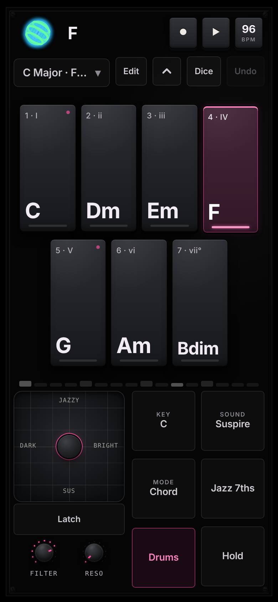
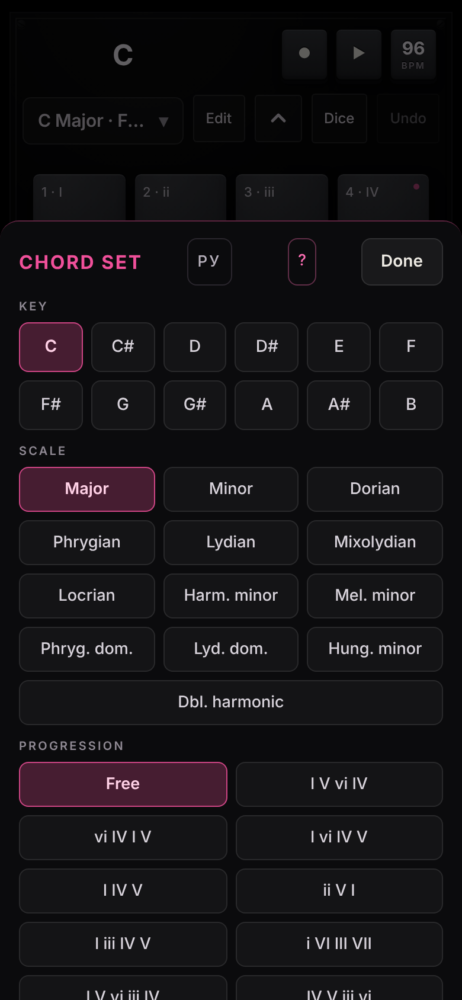
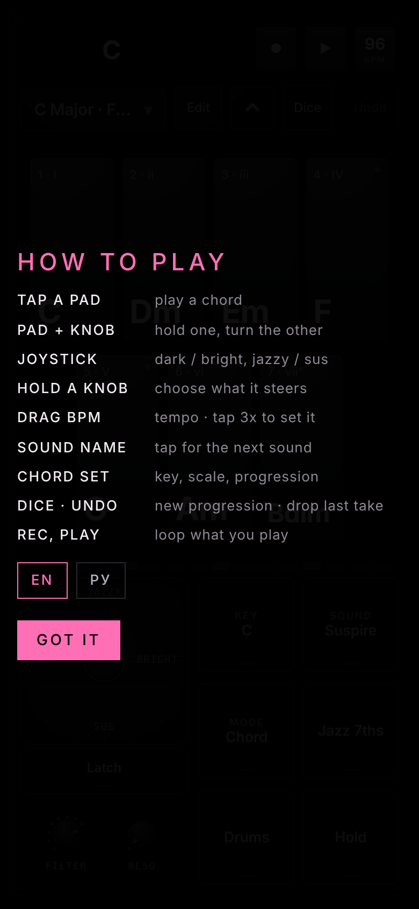
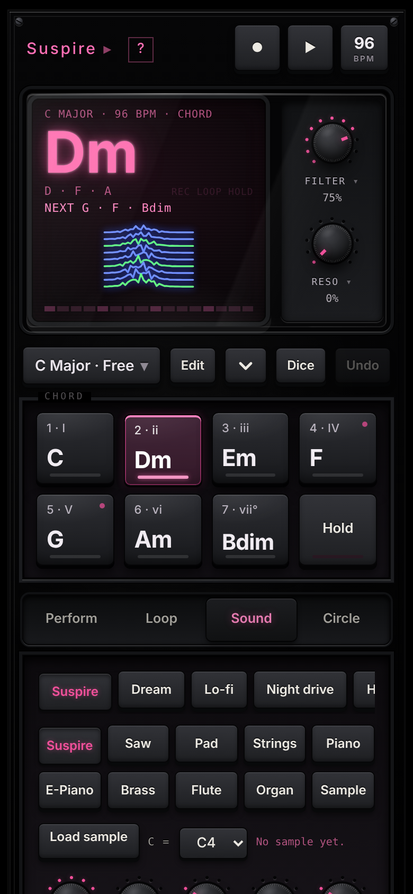
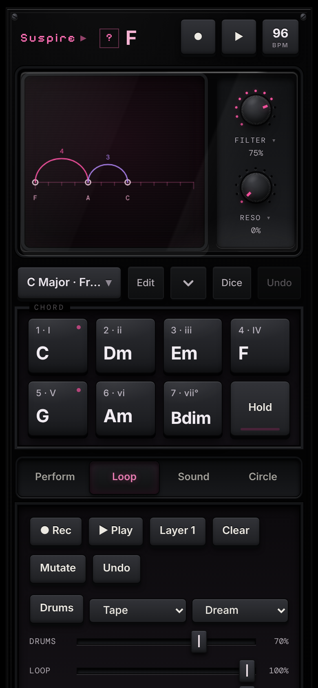
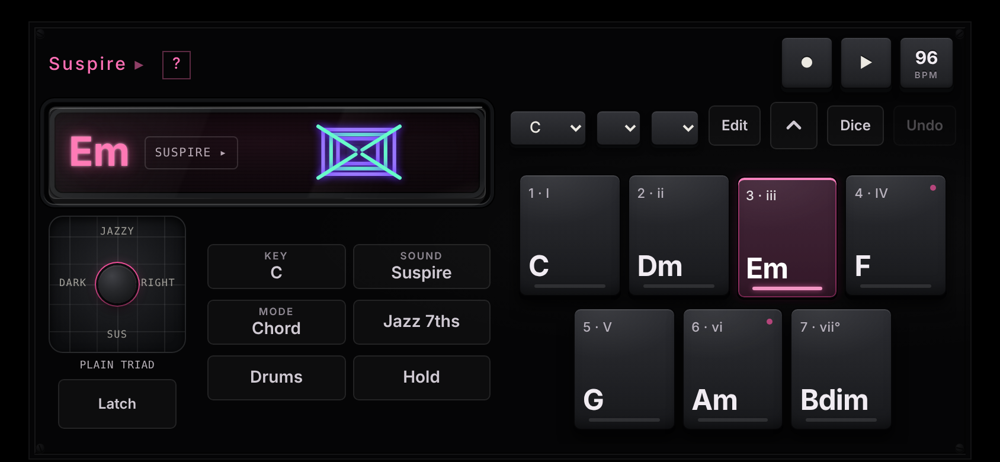

# SUSPIRE

A chord instrument for your phone: seven pads, one tap per chord, a joystick that makes it darker, brighter, suspended or jazzy. One HTML file, no dependencies, built for touch screens. Warm analog sound, a drum machine, a looper and MIDI export, and it installs as an app that runs offline. A pink-and-black sibling of [BEHEMOTH](https://shoogaze.github.io/behemoth-synth-/), [GRAINS](https://shoogaze.github.io/grains-synth/) and [ELEPHANT](https://shoogaze.github.io/elephant-sequencer/).

**Try it:** open [SUSPIRE](https://shoogaze.github.io/suspire-chord/) on your phone and tap a pad to start audio. On an iPhone or iPad use *Share → Add to Home Screen* for a full-screen app.

## Screenshots

Phone upright: the pixel boot screen, the play layout with drums running, the chord set sheet and the pixel how-to.

<p>
  
  
  
  
</p>
<p>
  
  
</p>

Phone held sideways: the display and all seven pads stay on screen.

<p>
  
</p>

## Playing

- **Pads:** the seven chords of the chosen key and scale, staggered in two rows. Every chord takes the inversion nearest to the last one, so progressions glide without any theory. Tap **Edit**, then a pad, to change which degree it plays.
- **Joystick:** chord colour on two axes, dark / bright and jazzy / sus. **Latch** keeps it where you leave it.
- **Two layouts:** the play layout puts the display, pads and quick buttons on one screen; the chevron button between Edit and Dice opens the full menu with Perform, Loop, Sound and Circle tabs.
- **Two hands:** hold a pad and turn a knob with the other thumb.
- **Chord set:** one button (`C Major · Free`) opens a sheet with key, scale and progression, plus the language switch.
- **Dice** writes a new progression in the current key, **Undo** removes the last recorded take.
- **Tempo:** drag the BPM chip in the header up or down, or tap it three times in time.
- **Help:** the pixel how-to shows on first run; the `?` button brings it back.

## Features

**Sound**
- Suspire voice: three detuned saws over a sub, a slow filter that opens and relaxes like an exhale, a breath of noise on the attack
- Saw, Pad, Strings, Piano, E-Piano, Brass, Flute, Organ, or your own sample
- Filter with resonance, chorus, delay and reverb with soft saturation and slow drift; attack, release and tremolo under Shape
- Two macro encoders: Filter and Reso by default, hold a knob to point it at Reverb, Delay, Chorus, Tremolo, Attack or Release
- Vibes: one tap sets instrument, effects, tempo, kit and pattern (Suspire, Dream, Lo-fi, Night drive, Hymn, Cinema)

**Chords**
- 13 scales: Major, Minor, Dorian, Phrygian, Lydian, Mixolydian, Locrian, Harmonic and Melodic minor, Phrygian dominant, Lydian dominant, Hungarian minor, Double harmonic
- Modes: Chord, Strum, Slop, Arp, Pattern, Harp; the arpeggiator has rate, order, octaves and gate
- Jazz 7ths, Hold, Key, and a circle of fifths on the Circle tab
- Smooth voicing: nearest inversion, root position, or an inversion you set

**Rhythm and loop**
- Drums: three kits (Tape, Analog, Soft), eight patterns, locked to the loop, with their own level
- Record chords and joystick motion into two layers; separate levels for the loop and each layer; mutate, undo, eight memory slots
- The scene square draws a figure from the chord you play and a laser stroke on every press

**Export**
- `.mid` (SMF type 0: chords, bass, drums on channel 10, layers on their own channels), `.wav` bounce with reverb tail, and a JSON backup of all slots. iOS has no Web MIDI, so files are the bridge to your DAW

**Phones and tablets**
- Portrait, landscape and tablet layouts, safe areas and dynamic viewport height for notched phones
- Interface languages: English and Russian (EN / РУ in the help overlay or the chord set sheet)
- Installable as an app (PWA): fullscreen, works offline once loaded; audio plays with the iPhone mute switch on (iOS 17+)

## Run

Open `index.html` in a modern browser and tap a pad to start audio, or run `npm run serve` and visit <http://localhost:8080>.

For install and offline use, serve the files over HTTPS, for example with GitHub Pages.

### GitHub Pages

Settings → Pages → Deploy from branch → `main` / root. The instrument is then available at `https://<user>.github.io/<repo>/`. On an iPad or iPhone use Share → Add to Home Screen.

## Files

| File | Purpose |
| --- | --- |
| `index.html` | The whole instrument, built from `src/` (this is the file to open or deploy) |
| `src/` | Source: `template.html`, `css/style.css`, `js/*.js` |
| `build.mjs` | Assembles `src/` into `index.html` (no dependencies) |
| `tests/` | Playwright tests, a static server and the screenshot script |
| `screenshots/` | README screenshots |
| `icons/`, `manifest.webmanifest`, `sw.js` | Install and offline support |
| `.github/` | CI: builds, checks that `index.html` is up to date and runs the tests on every push |
| `LICENSE` | MIT |

## Development

Edit the files in `src/`, then rebuild the single file (Node 18 or newer, nothing to install):

```
node build.mjs          # writes index.html
node build.mjs --check  # fails if index.html is out of date
npm test                # Playwright: layouts, pads, Dice and Undo, Russian, offline, exports
node tests/screenshots.cjs
```

`index.html` is committed so the instrument works straight from GitHub Pages. The JS files are concatenated in file-name order inside one scope, so a new file has to sort before `10-wiring.js`. After a change that users should receive, bump the cache name in `sw.js` so installed copies refresh.

## Browser support

Current Safari, Chrome, Edge and Firefox. Built and tuned for iPhone Safari; Web MIDI is not used.

## The family

SUSPIRE is the pink one. The three black-and-white instruments below share a design; open them on the same phone and add the ones you like to the Home Screen.

| App | What it is | Open | Source |
| --- | --- | --- | --- |
| **SUSPIRE** | Chord instrument with joystick, drums and looper | [shoogaze.github.io/suspire-chord](https://shoogaze.github.io/suspire-chord/) | [SHOOGAZE/suspire-chord](https://github.com/SHOOGAZE/suspire-chord) |
| **ELEPHANT** | Pocket sampler groovebox: 16 pads, p-lock sequencer, sampler, FX | [shoogaze.github.io/elephant-sequencer](https://shoogaze.github.io/elephant-sequencer/) | [SHOOGAZE/elephant-sequencer](https://github.com/SHOOGAZE/elephant-sequencer) |
| **BEHEMOTH** | Wavetable bass synthesizer with a modulation matrix | [shoogaze.github.io/behemoth-synth-](https://shoogaze.github.io/behemoth-synth-/) | [SHOOGAZE/behemoth-synth-](https://github.com/SHOOGAZE/behemoth-synth-) |
| **GRAINS** | Granular sampler and playable instrument | [shoogaze.github.io/grains-synth](https://shoogaze.github.io/grains-synth/) | [SHOOGAZE/grains-synth](https://github.com/SHOOGAZE/grains-synth) |

## License

[MIT](LICENSE). Copyright (c) 2026 Kirill Kinderhart.
