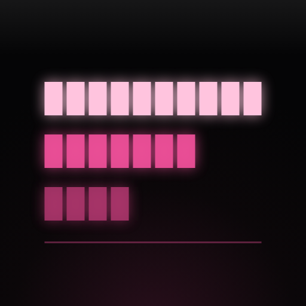
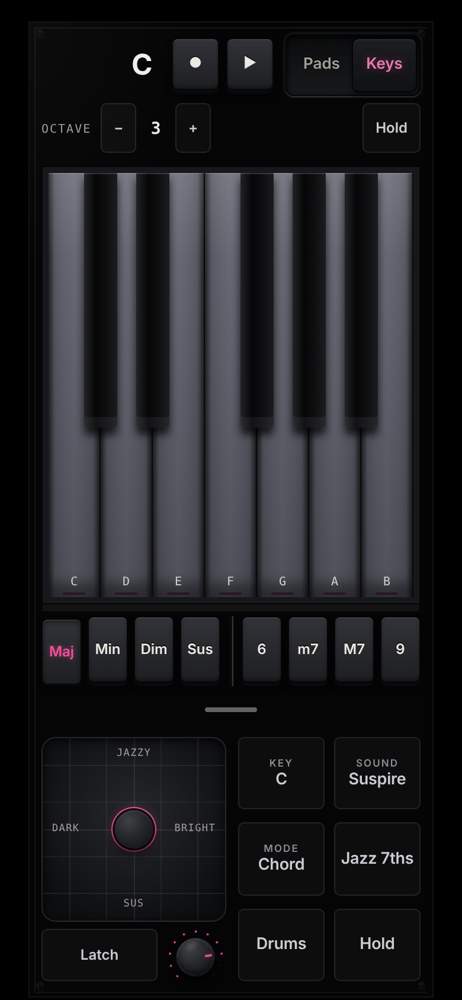

<p align="center"></p>

<h1 align="center">SUSPIRE</h1>
<p align="center"><b>Chords, exhaled.</b><br>A chord instrument for your phone. One file, no install.</p>

<p align="center"><a href="https://shoogaze.github.io/suspire/">Open the instrument</a> · <a href="#run-it">Run it</a> · <a href="#develop">Develop</a></p>

<p align="center">
  
  
  
</p>
<p align="center">
  
  
  
</p>

## What it is

Seven pads, the seven chords of a key. Tap one and a full chord sounds with a bass under it. Drag the joystick to make it darker, brighter, suspended or jazzy. Every chord takes the inversion nearest to the last one, so progressions glide without any theory.

The body is black. Pink appears only where something is sounding.

## Play

The default **Play layout** is built for two thumbs: the joystick and quick buttons under the left, the pads under the right.

- **Pads**: seven chords of the chosen key and scale, staggered in two rows. Each pad's chord is remapped by the progression you pick. Tap **Edit**, then a pad, to cycle which degree it plays.
- **Chord set**: one button (`C Major · Free`) opens a sheet with key, scale and progression.
- **Joystick**: chord colour on two axes (dark / bright, jazzy / sus). **Latch** keeps it where you leave it.
- **Quick buttons**: Key (up a fifth), Sound (next vibe), Mode, Jazz 7ths, Drums, Hold.
- **Scene square**: the small frameless figure in the header is drawn from the chord you play: a Lissajous curve from its intervals, Joy Division-style ridges, a tunnel, a wire globe, an octahedron, a radial ring, a torus. Shape, phase and tilt change on every press, line weight follows velocity. Tap it for the next vibe.
- **Step strip**: 16 steps under the pads show the drum pattern and the loop playhead.
- **Handle**: pull the handle under the pads up for the full menu (Perform, Loop, Sound, Circle); drag it down to get the screen back.
- **Keys**: a root keyboard with Maj, Min, Dim, Sus and 6, m7, M7, 9.
- **Modes**: Chord, Strum, Slop, Arp, Pattern, Harp. Arp has rate, order, octaves and gate.
- **Smooth voicing**: nearest inversion, or root position, or an inversion you set.

## Sound

- **Suspire voice** (default): three detuned saws over a sub, a slow filter that opens and relaxes like an exhale, a breath of noise on the attack.
- Saw, Pad, Strings, Piano, E-Piano, Brass, Flute, Organ, or your own sample.
- Tone, chorus, delay, reverb with soft saturation and slow drift; attack, release and tremolo under **Shape**.
- **Vibes**: one tap sets instrument, effects, tempo, kit and pattern (Suspire, Dream, Lo-fi, Night drive, Hymn, Cinema).
- **Drums**: three kits (Tape, Analog, Soft), eight patterns, locked to the loop.
- **Scales** (13): Major, Minor, Dorian, Phrygian, Lydian, Mixolydian, Locrian, Harmonic and Melodic minor, Phrygian dominant, Lydian dominant, Hungarian minor, Double harmonic.

## Loop and export

- Record chords and joystick motion into two layers; Clear wipes only the layer you are on. Mutate, undo, eight memory slots.
- **.mid** (SMF type 0: chords, bass, drums on channel 10, layers on their own channels), **.wav** bounce with reverb tail, and a **JSON backup** of all slots. iOS has no Web MIDI, so files are the bridge to your DAW.

## Run it

Open the [live version](https://shoogaze.github.io/suspire/) on your phone, then *Share → Add to Home Screen*. It opens full-screen and works offline after the first visit (service worker; needs HTTPS, which GitHub Pages gives you). Audio is requested as playback, so it sounds with the iPhone mute switch on (iOS 17+).

Locally: open `index.html`, or `npm run serve` and visit <http://localhost:8080>.

## Develop

`index.html` is a build artifact; the source lives in `src/` and is concatenated by a 30-line script, so there is no bundler and nothing to install to build.

```
suspire/
├── index.html            built single file (what GitHub Pages serves)
├── build.mjs             node build.mjs [--check]
├── sw.js                 offline cache (bump the version when assets change)
├── manifest.webmanifest
├── src/
│   ├── template.html     markup, with @@STYLES@@ and @@SCRIPT@@ slots
│   ├── css/              base → surfaces → depth → stage/tablet → play layout → phone play
│   └── js/               core, audio, drums, chords, modes, looper, display, playing, ui-pads, ui-keys, wiring
├── tests/                Playwright + node:test, a static server, the screenshot script
├── icons/  screenshots/
└── .github/workflows/    runs the tests on every push
```

```sh
npm install                 # playwright only, for tests and screenshots
npx playwright install chromium
npm run build               # src/ -> index.html
npm test                    # build check + 9 browser tests
npm run shots               # regenerate screenshots/
```

The tests load the real page in mobile Chromium and check: no console errors, pad tap lights the pad, names the chord and puts real signal on the audio destination; the scene square draws; the chord-set sheet remaps pads; portrait layout at 430, 414, 390 and 375 px wide (no horizontal scroll, labels not clipped); landscape; `.mid` and JSON export; offline reload through the service worker; and that `index.html` matches `src/`.

## Browser support

Safari on iOS 17+ is the target. Chrome and Safari on desktop work, with a phone-shaped layout. Needs Web Audio and CSS container queries.

## License

MIT, © Kirill Kinderhart. Pixelify Sans and Sora are loaded from Google Fonts (OFL); the app falls back to system fonts offline.
