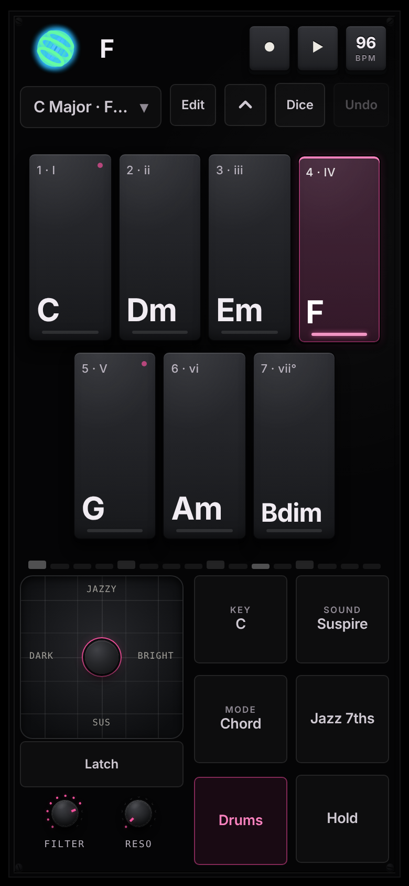
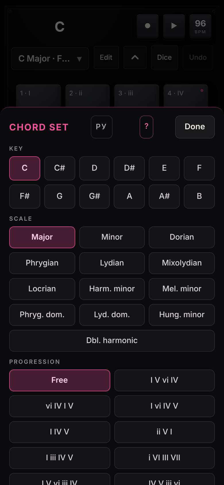
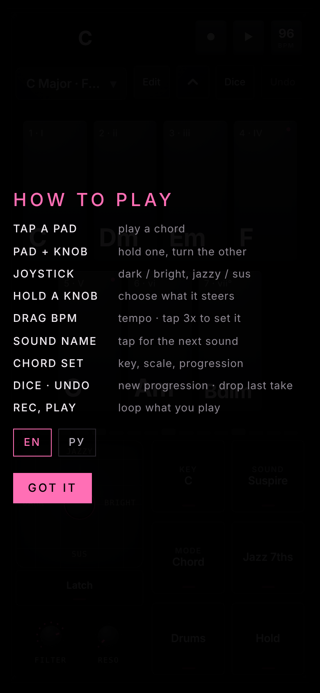
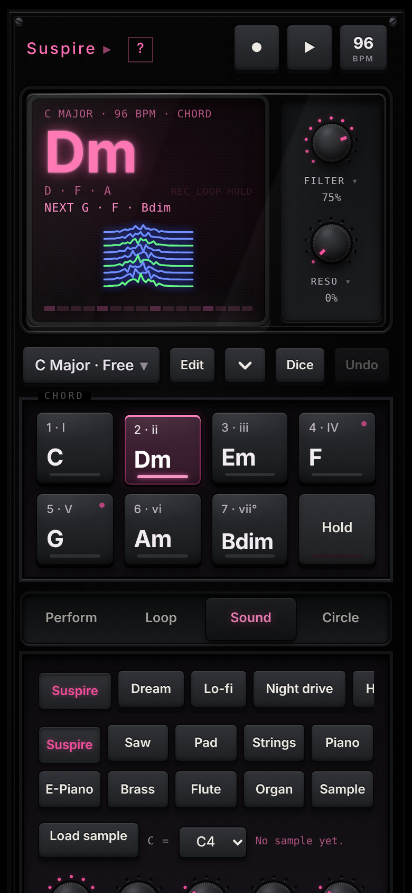
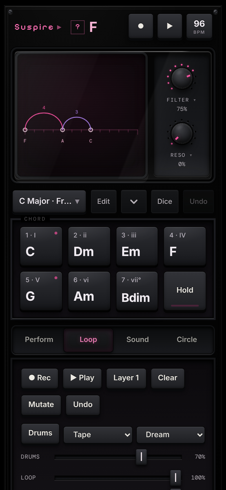
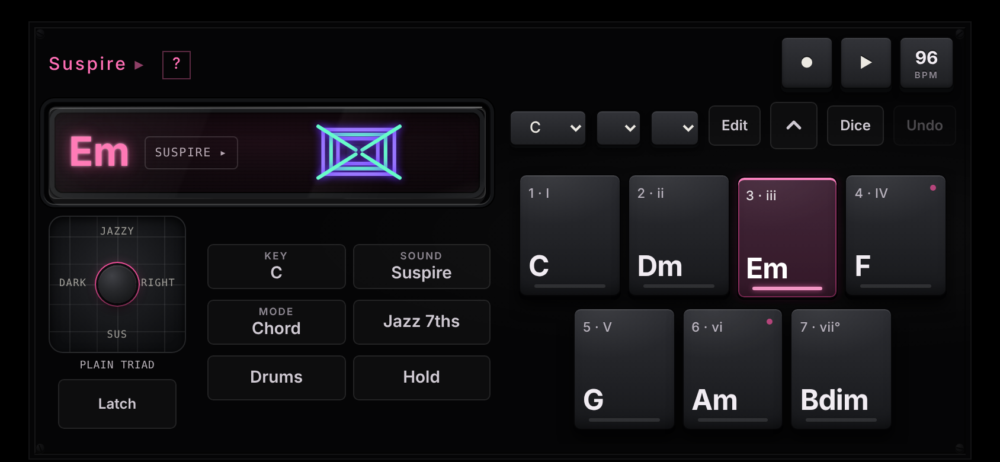

# SUSPIRE

**[▶ Open the app](https://shoogaze.github.io/suspire-chord/)**  ·  works in the browser, installs to the Home Screen

A single-file chord instrument for the phone: seven pads, one tap per chord, and a joystick that makes it darker, brighter, suspended or jazzy. Deep-black glass and hardware with one pink light, a warm analog voice, a pixel boot screen.

<!-- Demo: in the GitHub editor, drag extras/demo.mp4 here; it is uploaded and plays inline. -->

## Features

- **Pads**: the seven chords of the chosen key and scale, one tap each. Every chord takes the inversion nearest to the last one, so progressions glide without any theory
- **Joystick**: chord colour on two axes, dark / bright and jazzy / sus; Latch keeps it where you leave it
- **Sound**: a Suspire voice (three detuned saws over a sub, a slow filter that opens like an exhale), twelve instruments or your own sample, filter, chorus, delay and reverb, two macro encoders
- **Vibes**: one tap sets instrument, effects, tempo, kit and pattern (Suspire, Dream, Lo-fi, Night drive, Hymn, Cinema)
- **Scales and modes**: 13 scales; Chord, Strum, Slop, Arp, Pattern and Harp playing modes; a circle of fifths
- **Rhythm and loop**: three drum kits and eight patterns locked to a looper with two layers, memory slots, mutate and undo
- **Dice and Undo**: Dice writes a new progression in the current key, Undo removes the last take
- **Export**: `.mid`, `.wav` bounce with reverb tail, and a JSON backup of all slots
- **Installable**: add to the Home Screen and it works offline (PWA)

13 scales · 3 drum kits · 6 vibes · EN / RU · phone, tablet and landscape layouts · a pixel how-to on first run.

Two hands: hold a pad and turn a knob with the other thumb. Drag the BPM chip to set the tempo, or tap it three times in time.

## Screenshots

  
  
  
  

Boot &nbsp;·&nbsp; Pads &nbsp;·&nbsp; Chord set &nbsp;·&nbsp; How to play

  
  

Sound &nbsp;·&nbsp; Loop

### Landscape

  

## Run

Live build: https://shoogaze.github.io/suspire-chord/

Open `index.html` in a browser and tap a pad to start audio. No build step is needed to use it; `npm run serve` starts a local server at <http://localhost:8080>. For GitHub Pages: Settings → Pages → deploy from branch `main`, root.

**Install on iPhone:** open the site in Safari → Share → Add to Home Screen. It then runs full-screen and offline. Keep `manifest.webmanifest`, `sw.js` and the `icons/` folder next to `index.html`.

## Development

Source is in `src/`; `node build.mjs` writes the single `index.html` (Node 18+, nothing to install), `node build.mjs --check` fails if it is out of date, `npm test` runs the Playwright tests. After a change users should receive, bump the cache name in `sw.js`.

## License

[MIT](LICENSE) © 2026 Kirill Kinderhart
